# Flex

<a href="screenshots/home.jpg">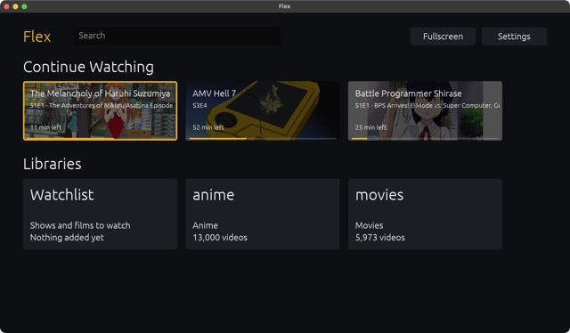</a>
<a href="screenshots/anime.jpg">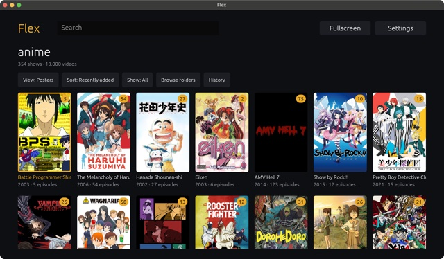</a>
<a href="screenshots/show.jpg">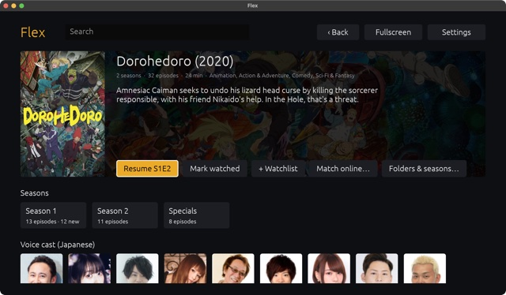</a>

A media player and organiser that scans your local libraries (local folders or mounted
drives) and sorts everything into Movies, Shows, Anime and Music collections. It runs
entirely locally, so there's no server to set up, and it can import an existing Plex
database to bring your watch history across.

Music libraries are sorted into albums and artists using your files' tags, with album
covers, artist photos and discographies pulled in from MusicBrainz.

It plays YouTube too, in the same player as everything else: your subscriptions and
search, with no ads, and sponsor segments skipped by
[SponsorBlock](https://sponsor.ajay.app). Between that and the libraries, pretty much
everything we watch goes through Flex now.

It's also really fast. I got fed up with how sluggish Plex is on my TV PC, and this
opens instantly and stays snappy even with tens of thousands of videos.

It's made to be used from the couch with a TV remote (arrows, OK and back are all you
need), but a keyboard and mouse work fine too.

And it has plugins, for bolting on extras that don't belong in a media player. We
wanted the LED strip behind our TV to glow with whatever's on screen, so the first
plugin does just that, talking to the strip over Bluetooth with
[lotus-lamp-rs](https://github.com/bombpersons/lotus-lamp-rs).

## Getting it running

Download Flex from the [releases page](https://github.com/catchouli/flex/releases/latest):

- **Windows:** run the `windows-x64-setup.exe` installer, or unzip the `windows-x64.zip`
  anywhere and run `flex.exe`. Everything it needs is included, so you can copy the
  folder to whichever PC is plugged into your TV.
- **Linux:** unpack the `linux-x64.tar.gz`, install libmpv from your distro
  (`apt install libmpv2` on Debian and Ubuntu) and run `flex`. To use a remote's media
  buttons, add yourself to the `input` group.
- **Mac:** there's no download yet, so you'll need to build it yourself.

To build Flex from source, see [BUILDING.md](BUILDING.md).

Once it's running:

1. Open Settings and add your libraries, picking whether each is Movies, TV, Anime or
   Music.
2. If you want posters, descriptions and episode names, get a free API read access token
   from [TMDB](https://www.themoviedb.org/settings/api) and paste it into Settings.
   Music is matched on [MusicBrainz](https://musicbrainz.org), which doesn't need a key.
3. If you're coming from Plex, use "Import from Plex…" and point it at your
   `com.plexapp.plugins.library.db`.

If something gets matched to the wrong show or album, open it and pick "Match online…"
(or "Folders & seasons…" for shows) to fix it.

## Several devices

If you run Flex on more than one machine (say the TV and a projector), they can share
what you've watched: Settings → Sync with other devices, then pick a folder they can all
reach, like a folder on your NAS. Each Flex keeps its own libraries (pointing at wherever
the media is on that machine, as long as the libraries have the same names) and they
swap watched state, resume points, history, the watchlist, matches you fixed by hand and
YouTube subscriptions through that folder every 30 seconds or so.

## YouTube

<a href="screenshots/youtube.jpg">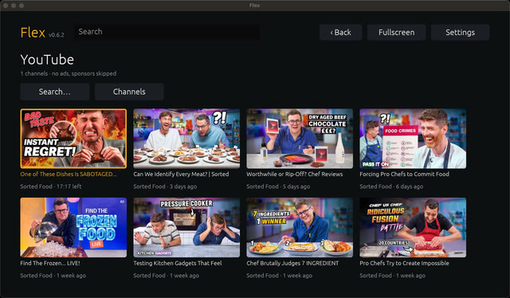</a>

Switch it on in Settings → YouTube and a YouTube card appears on Home. Flex fetches
[yt-dlp](https://github.com/yt-dlp/yt-dlp) (and [Deno](https://deno.com), which yt-dlp
needs for some of YouTube's checks) into its data folder by itself, and keeps them up to
date, since YouTube changes things a lot and a newer yt-dlp is usually the fix.

Add channels under Channels by pasting a link or an @handle, or import your existing
subscriptions from Google Takeout (`subscriptions.csv`), FreeTube, NewPipe or an OPML
file. New videos are picked up from each channel's feed every half an hour, so there's no
API key to set up. Search works too.

Videos take a few seconds to start, since yt-dlp has to ask YouTube for them first, but
Flex starts on whichever video you have highlighted, so it's usually ready by the time you
press OK. Hold OK on a video to mark it watched or jump to its channel. Settings →
YouTube also has the quality limit (1080p unless you change it), whether to show Shorts
(hidden by default) and which SponsorBlock categories to skip (sponsors, self-promotion
and "like and subscribe" reminders by default).

## Themes

Settings → Theme changes how Flex looks. As well as the usual dark look, there are a few
for fun, mostly after games and old computers we like: Final Fantasy VII's blue windows
and pointing hand, Old School RuneScape's stone pillars and parchment chatbox (and
Brick, its brown bevels on a stone wall), Pokémon's text boxes,
Windows 95 and XP, early Mac OS X, a green-on-black hacker terminal with code raining
down, TempleOS, and Maisy's farm, with hens and runner ducks by the pond. Everything is
drawn by Flex; no pictures are taken from the games.

| | |
|:-:|:-:|
| <a href="screenshots/themes/dark.jpg">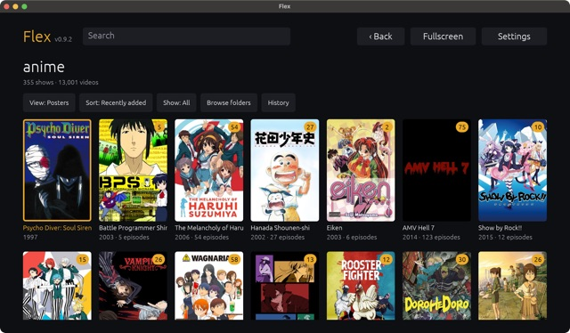</a> Dark (default) | <a href="screenshots/themes/ff7.jpg">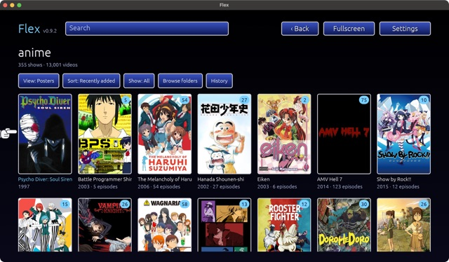</a> Final Fantasy VII |
|  Old School RuneScape | <a href="screenshots/themes/brick.jpg">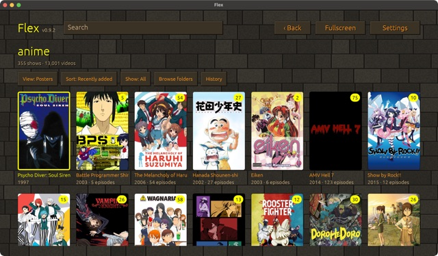</a> Brick |
| <a href="screenshots/themes/pokemon.jpg">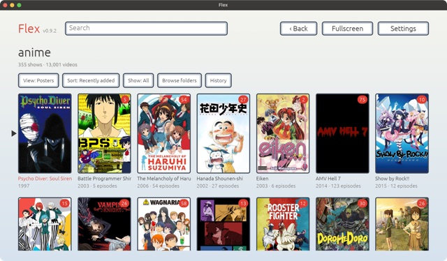</a> Pokémon | <a href="screenshots/themes/win95.jpg">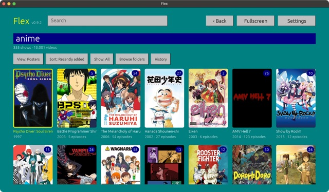</a> Windows 95 |
| <a href="screenshots/themes/winxp.jpg">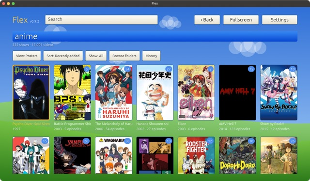</a> Windows XP | <a href="screenshots/themes/aqua.jpg">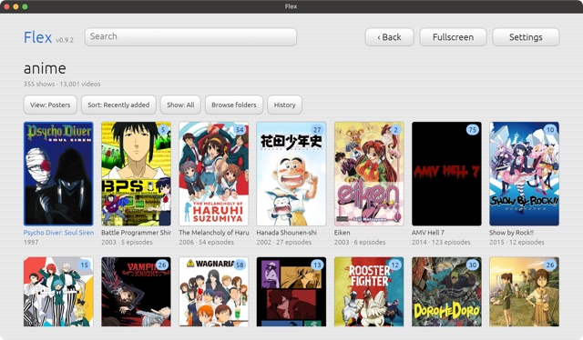</a> Aqua |
| <a href="screenshots/themes/terminal.jpg">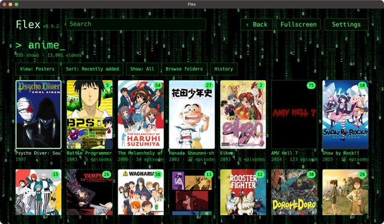</a> Terminal | <a href="screenshots/themes/templeos.jpg">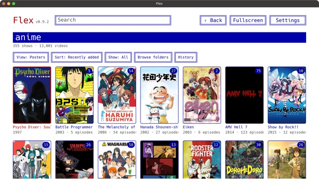</a> TempleOS |
| <a href="screenshots/themes/farmyard.jpg">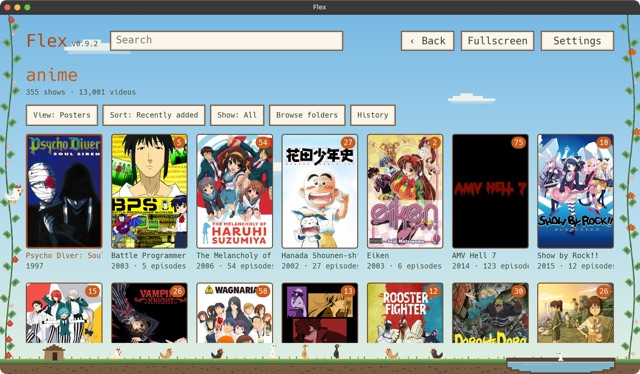</a> Maisy's Farm | |

A theme is a small TOML file of colours and styles, so making your own is mostly a
matter of copying one and changing the colours. Custom themes go in the `themes` folder
in Flex's data folder (Settings → Theme → "Open themes folder") and can bring their own
background picture, pointer and font. See [THEMES.md](THEMES.md).

## Plugins

Plugins live in a `plugins` folder, either next to `flex.exe` (releases come with the
LED strip one) or in Flex's data folder (Settings → Plugins → "Open plugins folder").
Every plugin is off until you switch it on in Settings → Plugins, and one that's off
never runs, so they cost nothing if you don't use them. `cargo build --release
--workspace` builds the plugins in this repo along with Flex.

For the LED strip, switch on "LED strip (Lotus Lamp)" and press play. It connects to
the first strip it finds and remembers it; "Find strips" lets you pick another.
Settings → Ambient light chooses between the whole picture and just its edges, how
smoothly it changes, how vivid and bright it is, and what it shows when you're not
watching anything (a dim warm white unless you change it). Press F2 during a video to
see the colour being sent.

There's also a [Trakt](https://trakt.tv) plugin, which keeps your Trakt history up to
date with what you watch: switch it on, choose "Connect to Trakt" and enter the code it
shows at the address it gives (auth.trakt.tv/activate) on your phone.

Flex works out the colour itself and only samples the screen while a light plugin is
running, so a plugin for a different kind of light only has to pass it on. A plugin is
just a program that reads and writes lines of JSON, so you can write one in whatever
you like. See [PLUGINS.md](PLUGINS.md).

## Remote controls

Arrows to move, OK to select, Back to go back. Hold OK for more options, and hold Back
to quit. Play/pause, stop and next/previous work if your remote has them, and on my
remote zoom+ toggles fullscreen and zoom- jumps to search.
